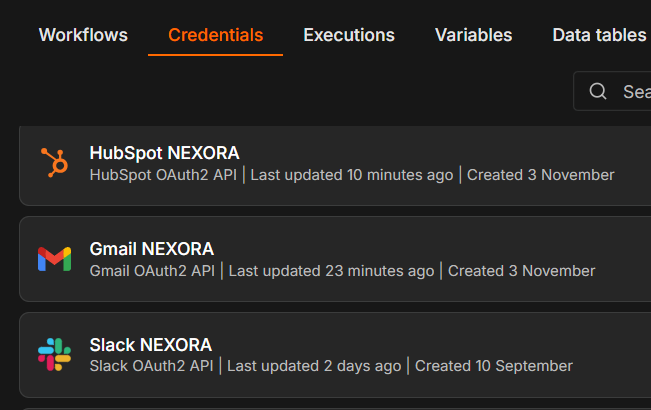

# NEXORA | AgroTech
**Pre-entrega 4 — Integraciones Avanzadas**  
**Estudiante:** Edgar Pedauga | **Coderhouse**

## Proyecto

NEXORA es una plataforma multiagente desarrollada en **n8n Self Hosted** para AgroTech, una empresa ficticia B2B de tecnología agrícola.

Continúa el Módulo 3, conservando la memoria conversacional en Airtable y sumando integraciones reales mediante OAuth2.

## Arquitectura e integraciones

Un **Manager** recibe solicitudes desde Telegram y Gmail, las clasifica y deriva a tres Workers: Comercial, Operaciones y Recursos Humanos.

- **HubSpot:** búsqueda y verificación de contactos.
- **Gmail:** recepción de consultas y creación de borradores.
- **Slack:** notificaciones y supervisión humana (HITL).
- **Groq y Airtable:** inteligencia artificial y memoria persistente.

## Controles de seguridad

1. **IF anti auto-reply:** bloquea correos automáticos.
2. **Lookup CRM:** verifica contactos antes de considerar su creación.
3. **Create Draft:** prepara correos sin enviarlos automáticamente.
4. **Set:** limpia el payload antes de Slack.

Las escrituras en HubSpot permanecen bloqueadas y las acciones sensibles requieren autorización.

## Pruebas y resultados

Se completaron pruebas de regresión en Telegram y Gmail, búsquedas en HubSpot y controles HITL en Slack.

También se resolvió un error de límite de tokens de Groq mediante un nodo Wait de 15 segundos.

## Evidencia OAuth2

[HubSpot](evidencias/HubSpot%20credential.png) · [Gmail](evidencias/Gmail%20credential.png) · [Slack](evidencias/Slack%20credential.png)

## Archivos

- `checkpoint4_edgar_pedauga.json` — Manager principal.
- `sub workflows/` — Workers y servicio HubSpot.
- `evidencias/` — Capturas de autenticación.

**Importación:** importar primero los subworkflows y después el Manager; configurar credenciales propias y revisar las referencias.

**Estado:** Prototipo funcional M4. Auditoría de scopes OAuth2 pendiente.
